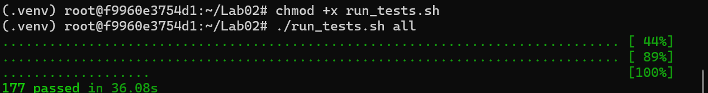
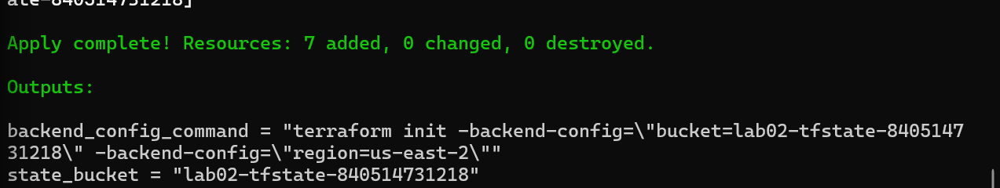
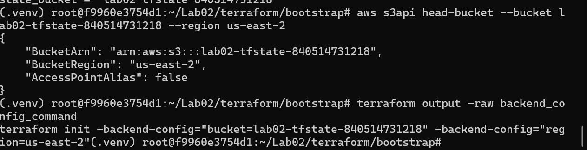
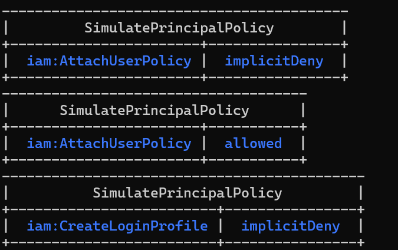
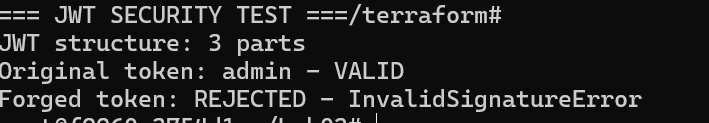
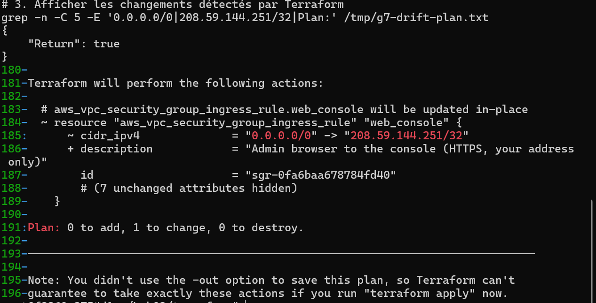
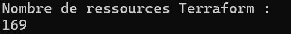
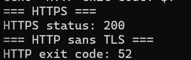
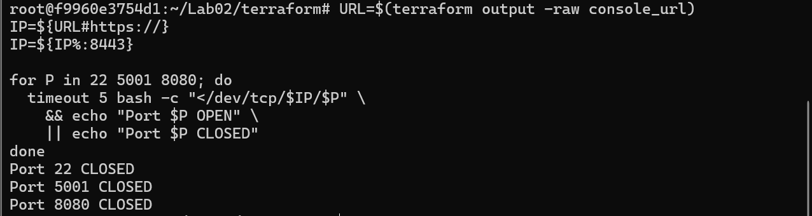
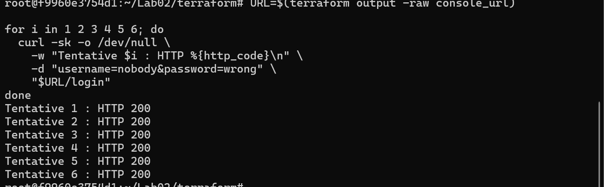

# Lab02: Identity Management as Code with Terraform: Public and Private Subnets, One EC2 Server per Microservice, Cognito JWT Sign In and Layered Security on the AWS Free Tier

## Part A: Run the Tests Locally

## Part B: Remote Terraform State

### Q1. State is a secret.

The Terraform state is sensitive because it includes values required to manage deployed resources, including the Cognito administrator password generated by Terraform, the internal service authentication token, and private TLS keys for the certificate authority and services. The Flask cookie-signing key is another example. Terraform retains these values as part of resource attributes and dependencies; marking an output sensitive does not remove its value from state.

The main state is stored in an S3 backend. The bootstrap configuration protects its bucket with S3 Block Public Access, bucket-owner-enforced object ownership, AES-256 server-side encryption, versioning, a policy denying insecure transport, and lifecycle expiration of noncurrent versions. IAM policies control access. The backend sets encrypt = true and use_lockfile = true. The lock file prevents concurrent state-changing Terraform operations from overwriting each other, while versioning permits recovery of previous state versions. Both the state and any saved plan files must be treated as secrets.

## Part C: The Two Tier Network

### Q2. What makes a subnet private?

A subnet is effectively private when its associated route table does not provide a direct path to an Internet Gateway. In network.tf, the public route table has a default route (0.0.0.0/0) targeting the Internet Gateway. The private route table instead has a 0.0.0.0/0 route whose target is the NAT instance network interface. The aws_route_table_association resource selects the public or private route table according to each subnet’s public property.

Adding a route to an Internet Gateway would undermine the intended private routing design, but a route alone would not necessarily make the services internet-reachable: public addressing, security groups, and NACLs still matter. The NAT instance provides controlled outbound HTTPS to services such as IAM. It is economical for a small lab, but requires maintenance and is a single point of failure. A managed NAT Gateway is more resilient and operated by AWS, but incurs hourly and traffic charges. Interface VPC endpoints provide private paths to supported services without a NAT or public internet, but have per-endpoint and data-processing costs; the lab also uses a gateway endpoint for S3.

Observed evidence: Web and NAT had public IP addresses; Onboarding (10.20.11.10), Offboarding (10.20.12.10), and Dashboard (10.20.11.11) had no public IP addresses.

Q3. Two firewalls.

The public subnet NACL first allows the administrator’s /32 address to port 8443 (rule 100). Rule 105 then explicitly denies all other sources to port 8443. This deny is necessary because rule 120 permits inbound ephemeral ports from any source, and 8443 lies within that range. NACL rules are evaluated in ascending numerical order, so the specific deny must come before the broad ephemeral-port allow.

NACLs are stateless: return traffic needs its own inbound or outbound rules. Security Groups are stateful, so response packets are permitted for established allowed connections without separate reply rules. A NACL can explicitly deny traffic at a subnet boundary; a Security Group can express an allow rule using another Security Group as the source. External attempts to connect to ports 22, 5001, and 8080 all failed in H1, consistent with the network controls.

## Part D: Identity as Code

### Q4. One server, one role.

Each microservice runs on a different EC2 instance with its own IAM role. A compromise of the Web or Dashboard service therefore does not automatically provide the IAM capabilities of Onboarding or Offboarding. This enforces least privilege and limits the blast radius of credential theft or application compromise.

The onboarding template uses an ArnEquals condition on iam:PolicyARN to restrict iam:AttachUserPolicy to the Nimbus-RequireMFA managed policy. It also confines user operations to the /nimbus/ IAM path. Without such limitations, an attacker could exploit CreateUser and AttachUserPolicy to create a privileged identity.

Three AWS IAM policy simulations were completed: attaching AdministratorAccess to a Nimbus user returned implicitDeny; attaching Nimbus-RequireMFA returned allowed; creating a login profile for the existing non-Nimbus IAM user returned implicitDeny. These are observed simulation results, not merely expected outcomes

## Part E: Secrets and Mutual TLS

### Q5. Layers between services.

Network restrictions limit connections to approved subnets, instances, and ports; they reduce external access but do not stop a malicious request from a permitted source. Mutual TLS verifies that services present certificates issued by the lab CA and encrypts traffic; it does not establish the authority of the human administrator behind an API request. An internal token supplies another application authentication factor; however, the same token can be reused by an attacker who steals it. An administrator access JWT enables verification of the Cognito issuer, signature, expiration, app client, and admin group; however, a stolen valid bearer token may still be replayed before expiry.

The service certificates have a 72-hour validity period, reducing the period of exposure if a private key is compromised and encouraging regular renewal in a longer-lived deployment.

### Q6 (explore). Where should secrets live?

SSM Parameter Store SecureString provides KMS-backed encryption, IAM access controls, and CloudTrail-integrated auditing, with relatively low complexity and cost. Rotation generally requires custom automation. AWS Secrets Manager is purpose-built for secrets and offers managed integration with automatic rotation workflows, granular IAM controls, and auditability, at a higher service cost. HashiCorp Vault supports dynamic credentials, leasing, revocation, flexible identity policies, and audit devices across multiple platforms, but adds deployment, operation, or managed-service overhead.

Generating a secret in Terraform and immediately writing it to SSM or Secrets Manager does not prevent the generated value from being included in Terraform state. Safer designs include generating and rotating secrets outside Terraform, with applications resolving them at runtime, or using provider-supported write-only attributes and ephemeral values where available. A securely configured backend remains necessary for any secrets that do enter the state.

## Part F: Cognito and JWT

### Q7. Anatomy of a JWT.

A standard signed JWT has three dot-separated Base64URL components: header, payload, and signature. The header identifies the signing algorithm and key identifier; the payload contains claims; the signature provides authenticity and integrity. Base64URL encoding is not encryption, so none of these three components is confidential merely because it forms part of a JWT.

The project’s verify_jwt function requires a properly formed token, obtains the Cognito JWKS signing key, and verifies RS256, signature, issuer, expiration, and required claims (exp, iat, iss, sub). It then checks token_use = access, the configured client_id, and membership in the admins group. Signature validation prevents claim tampering; issuer validation rejects tokens from other pools; expiration validation reduces the lifetime of replayed tokens; group membership prevents non-admin accounts from calling protected endpoints.

Observed: a three-part JWT signed with a generated RSA private key was accepted by PyJWT; after the username claim was changed without updating the signature, verification rejected it with InvalidSignatureError. This demonstrates the signature principle but is not verification of a real Cognito token, which was unavailable because MFA onboarding was incomplete.

### Q8 (explore). The limits of a bearer token

A bearer token authorizes whoever possesses it, so removing an employee or disabling an account does not necessarily invalidate a previously issued, self-contained access JWT at every verifier. The 30-minute token lifetime limits this window but does not make revocation immediate. A production design should also apply appropriate session termination, short token lifetime, token refresh controls, and high-risk action authorization checks.

USER_PASSWORD_AUTH, used in this lab, sends the username and password through the application’s custom authentication flow and handles Cognito challenges in application code. The OAuth 2.0 Authorization Code flow with PKCE uses an authorization redirect and a proof-of-possession-style code challenge to protect the code exchange, reducing the need for a custom application to collect credentials. For production, I would choose Cognito managed login with Authorization Code and PKCE, HTTPS, secure session management, and a carefully chosen token lifetime.

## Part G: Plan, Apply and Drift

### Q9. Plan, drift and immutable servers.

The command terraform state list \| wc -l returned 169. This is the number of resource instances tracked in the current Terraform state; it should not be confused with the number created during the original initial apply, which was not preserved as a separate count. Terraform plan uses + for creation, ~ for an in-place change, - for destruction, and -/+ for replacement.

Application files are archived and uploaded under a name derived from their SHA-256 hash. The resulting artifact key and hash are included in instance bootstrap configuration. A code change therefore changes the bootstrap configuration and replaces affected EC2 instances rather than patching them in place: an immutable deployment approach.

In the G7 drift experiment, the Web Security Group rule on port 8443 was manually widened from the administrator CIDR 208.59.144.251/32 to 0.0.0.0/0. Terraform refreshed its view of the remote rule and produced a plan with 0 to add, 1 to change, and 0 to destroy; the rule was shown as an in-place update (~) back to the restricted CIDR. We restored the original CIDR using AWS CLI and verified the resulting rule. Terraform recognized the edit because it managed the existing rule. A separately added unmanaged rule would not automatically be imported into Terraform state and might therefore not be included as a change to that managed rule; it would require separate discovery, import, or a configuration mechanism that manages the complete rule set.

## Part H: Security Experiments

### Q10 (explore). Prove it, then reflect.

H1 observations: HTTPS GET /login returned HTTP 200. Plain HTTP sent to the TLS port produced curl exit code 52, indicating an empty reply rather than a valid HTTP response. Six security headers were present: X-Content-Type-Options: nosniff, X-Frame-Options: DENY, Referrer-Policy: no-referrer, Content-Security-Policy, Cache-Control: no-store, and HSTS with max-age=86400. TCP probes to ports 22, 5001, and 8080 failed. The three private application instances had no public IP addresses. The Nimbus S3 bucket reported all four Public Access Block settings as true, default AES256 encryption, and versioning Enabled.

The login lockout experiment did not produce its expected result: all six incorrect login attempts returned HTTP 200, rather than HTTP 429 on the sixth attempt. This is a potential weakness or test-environment limitation. The application uses a per-process in-memory failure counter, which could explain the observation if Gunicorn workers processed different requests, but this cause has not been confirmed.

H4 observations: /lab02/flow contained TCP REJECT events. The first ten retrieved events concerned the NAT instance; they do not directly demonstrate the earlier specific Web port probes. The /lab02/app web-error stream showed TLS certificate_unknown warnings and an HTTP_REQUEST-to-TLS-port warning. The web-access stream showed login redirects and multiple POST /mfa responses with HTTP 302. An HTTP 302 only indicates redirection and does not prove successful MFA enrollment; Cognito subsequently showed no configured MFA method.

IMDSv2 requires a session token for metadata requests. A token-response hop limit of one helps prevent the token from being passed through additional network hops, limiting some proxy or container hop attacks. Session Manager provides IAM-based access control, removes the need for open SSH ingress, and can integrate session logs and audit records with AWS services when configured; conventional SSH requires separately established access and logging controls.

## References

https://developer.hashicorp.com/terraform

https://docs.aws.amazon.com/vpc/latest/userguide/what-is-amazon-vpc.html

https://docs.aws.amazon.com/IAM/latest/UserGuide/reference_policies_evaluation-logic.html

https://docs.aws.amazon.com/systems-manager/latest/userguide/systems-manager-parameter-store.html

https://docs.aws.amazon.com/secretsmanager/latest/userguide/intro.html

https://developer.hashicorp.com/vault/docs

https://docs.aws.amazon.com/cognito/latest/developerguide/amazon-cognito-user-pools-using-tokens-verifying-a-jwt.html

https://docs.aws.amazon.com/AWSEC2/latest/UserGuide/configuring-instance-metadata-service.html

https://docs.aws.amazon.com/systems-manager/latest/userguide/session-manager.html
